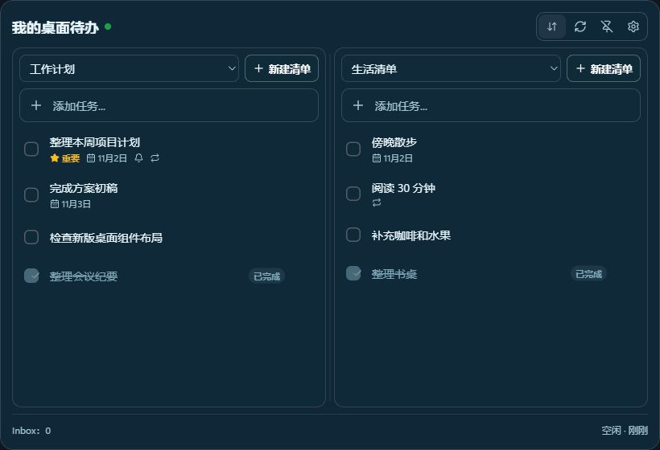
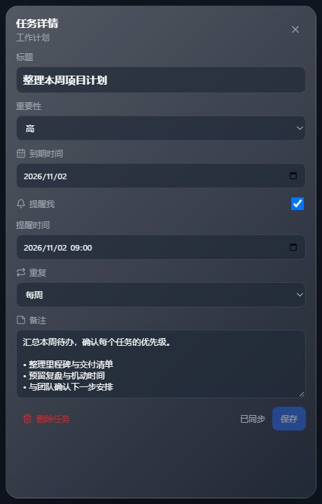
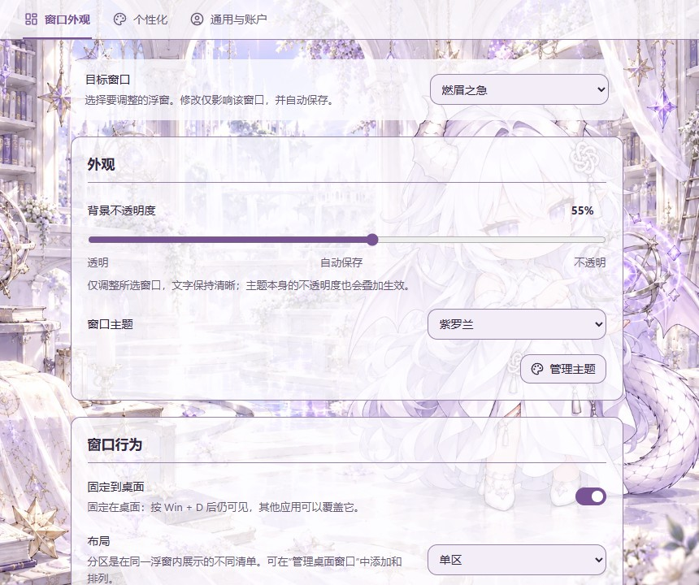
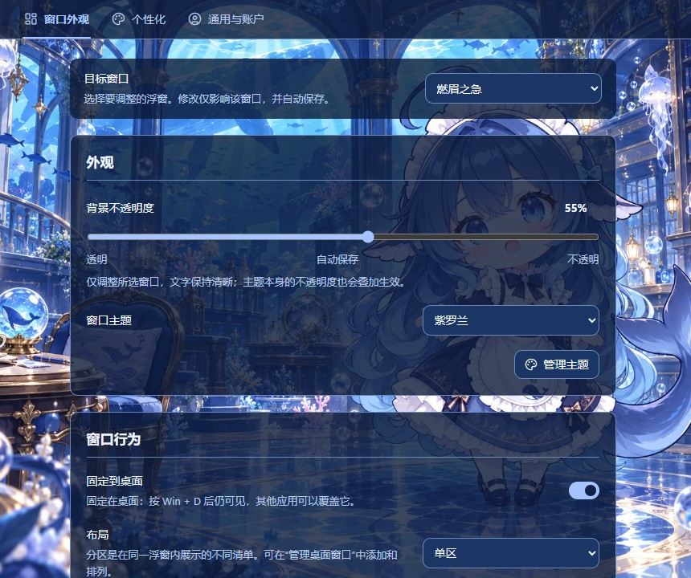
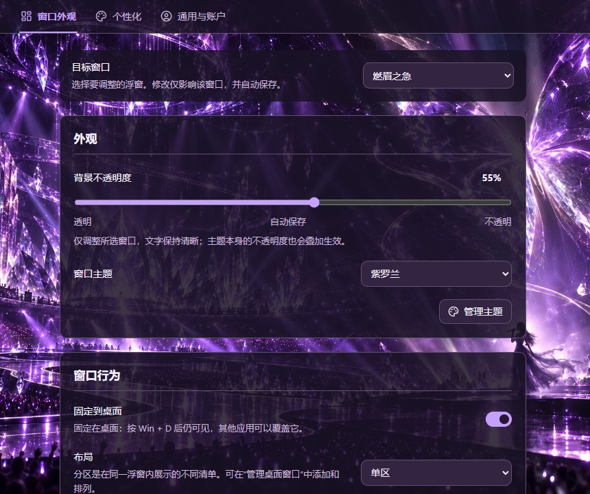
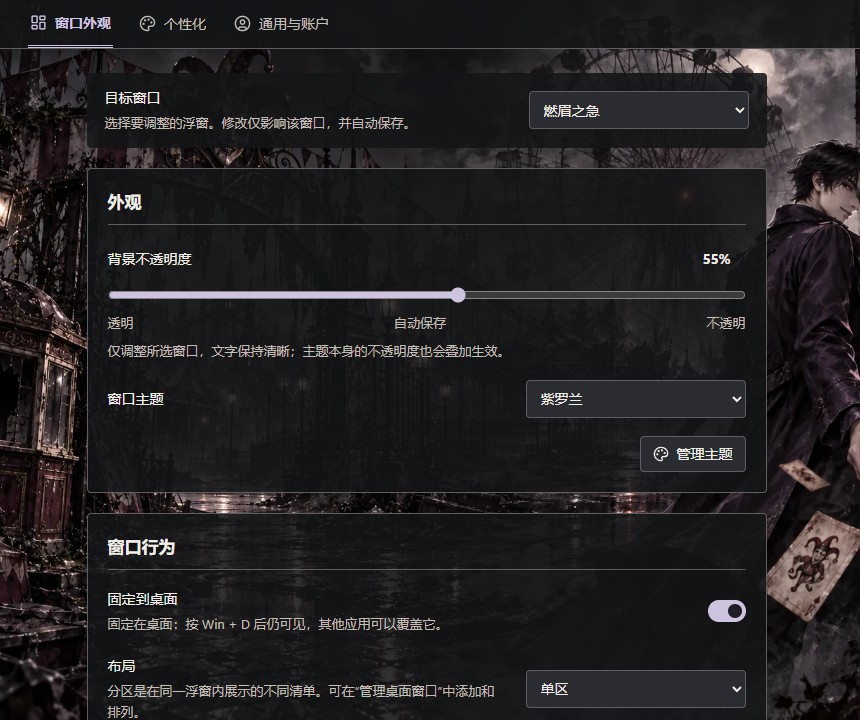

# Todo Desktop Widget

**简体中文** | [English](README.en.md)

把 Microsoft To Do 清单放在 Windows 桌面上的轻量待办组件。支持多个独立浮窗、同一窗口内的多个清单分区、本地离线任务操作，以及统一的设置窗口。

[下载 Windows 安装包](https://github.com/ArthurLloyd/Todo-Desktop-Widget/releases/latest) · [版本记录](https://github.com/ArthurLloyd/Todo-Desktop-Widget/releases) · [反馈问题](https://github.com/ArthurLloyd/Todo-Desktop-Widget/issues)

基于 [Chenzo1001/Microsoft-Todo-Desktop-Widget](https://github.com/Chenzo1001/Microsoft-Todo-Desktop-Widget) 改编，由 **涂风** 独立维护，非 Microsoft 官方应用。

## 主要功能

- **Microsoft To Do 同步**：登录 Microsoft 账户，查看、创建清单，管理任务的日期、提醒、重要性与备注。
- **多个桌面浮窗**：独立创建、复制和管理浮窗，每个浮窗可显示多个清单分区。
- **灵活布局**：支持单区、列、行、网格布局，拖动分隔线调整分区大小。
- **离线任务操作**：新增、修改、完成和删除先保存到本地，恢复联网后继续同步。
- **独立外观设置**：浮窗分别保存主题与背景不透明度；设置与管理页面另有四种简约配色和四套插画场景。
- **Windows 桌面集成**：固定到桌面、系统托盘、开机启动，以及 `Ctrl + Alt + T` 快捷添加。

## 界面预览

以下截图均来自本项目 **v0.2.1 修改版界面**，使用示例数据。主界面与任务详情由当前前端组件直接渲染，截图来源见[截图说明](assets/screenshots/README.md)。

### 桌面主界面

双清单分区、独立清单选择、新建清单入口与已完成任务展示：



### 任务详情

任务标题、重要性、到期时间、提醒、重复规则与备注：



### 个性化设置

四套个性化场景独立应用于设置与管理页面，桌面清单保留各自的主题与布局。

| ChatGPT · 白色龙娘 | DeepSeek · 蓝色鲸娘 |
| --- | --- |
|  |  |

| 邓紫棋 · 紫夜舞台 | 封不觉 · 黑色剧场 |
| --- | --- |
|  |  |

## 下载与安装

当前版本为 **v0.2.1**，提供 **Windows x64** 安装包。在 [Releases](https://github.com/ArthurLloyd/Todo-Desktop-Widget/releases/latest) 中选择：

| 文件 | 用途 |
| --- | --- |
| `Todo.Desktop.Widget_0.2.1_x64-setup.exe` | 推荐的当前用户安装包（NSIS） |
| `Todo.Desktop.Widget_0.2.1_x64_en-US.msi` | 适合已有 MSI 安装的环境 |
| `SHA256SUMS.txt` | 安装包 SHA-256 校验值 |

下载安装包后运行，启动应用并按下方步骤登录。安装包未进行代码签名，Windows 可能显示未知发布者提示。已有版本请沿用原安装包类型与安装目录，具体见[Windows 打包与升级](#windows-打包与升级)。macOS 源码与 WidgetKit 扩展保留在仓库中，尚无经过本项目验收的 macOS 安装包。

## 0.2.1 更新

- **四套完整个性化场景**：新增 **邓紫棋 · 紫夜舞台**（紫色舞台）、**封不觉 · 黑色剧场**（黑色剧场）、**ChatGPT · 白色龙娘**（白发龙角龙尾拟人）和 **DeepSeek · 蓝色鲸娘**（蓝发鲸尾女仆拟人）。每套场景独立呈现设置与管理页面，不改变桌面清单的外观与布局。
- **独立个性化标签页**：设置分为“窗口外观”“个性化”“通用与账户”三个标签页；保留 Default / Ocean / Violet / Forest 四种简约配色与“跟随所选窗口”，主题选择自动保存。
- **圆角与标题整理**：修复桌面浮窗四角的直角残留，移除重复标题，保留清晰的页面与分组层级。
- **不透明度直接输入**：保留滑块；双击百分比，或聚焦后按 Enter / Space，可输入 0–100 的整数。Enter 或失焦保存，Esc 取消。

四套背景均为完整横向场景，左右两侧都有环境细节；背景铺满窗口，文字与控件采用局部底色保护可读性，装饰层不接收鼠标事件。ChatGPT 与 DeepSeek 使用社区确认的龙娘、鲸鱼娘形象扩展场景，素材署名与 CC BY-NC-SA 4.0 说明见[主题素材来源](src/assets/themes/NOTICE.md)。

设置预览（示例数据）：[ChatGPT · 白色龙娘](assets/Theme-ChatGPT.jpg) · [DeepSeek · 蓝色鲸娘](assets/Theme-DeepSeek.jpg) · [邓紫棋 · 紫夜舞台](assets/Theme-GEM.jpg) · [封不觉 · 黑色剧场](assets/Theme-Feng.jpg)。验证范围见 [0.2.1 验证记录](docs/VALIDATION-0.2.1.md)。

## 0.2.0 更新

- **独立设置窗口**：点击任一浮窗的设置按钮即可打开，分为“窗口外观”“通用与账户”两个标签页；在“窗口外观”中选择要编辑的窗口，浮窗保持可见。
- **每个浮窗单独保存不透明度**：调整所选窗口不会改变其他窗口；关闭后重新打开、重启应用仍会保留。复制浮窗时复制其不透明度，之后分别调整。
- **直接新建 Microsoft To Do 清单**：在浮窗清单下拉框右侧点击“新建清单”，输入名称，点击“创建并使用”。成功后清单保存到 Microsoft 账户并绑定当前分区。
- **启动边缘修复**：关闭透明无边框浮窗的系统阴影，并在恢复窗口模式后刷新原生边框，处理启动时可能出现的右侧残留边缘。保留拖动、缩放与桌面固定能力。
- **字体与交互整理**：设置正文默认 14px、说明 13px、分组标题 17px、页面标题 20px；统一控件高度、对齐和间距，补充保存状态、键盘焦点、失败提示及减少动效支持。
- **清单入口**：新建按钮放在清单下拉框右侧，背景为 50% 不透明度，文字与图标保持完整不透明度。

## 开始使用

1. 启动应用，打开 **设置 → 通用与账户**，登录 Microsoft。
2. 回到浮窗，从下拉框选择已有清单，或者点击 **新建清单**。
3. 输入任务标题并按 Enter；点击复选框完成任务，点击详情按钮编辑日期、提醒、重要性和备注。
4. 需要更多浮窗时，进入 **设置 → 窗口外观 → 管理桌面组件**。可以创建、复制、显示或关闭附加浮窗，也可以添加清单分区。

**窗口名与清单名不同。** 修改窗口名称只改变本地浮窗的标题；“新建清单”才会在 Microsoft To Do 中创建清单。同一清单可以显示在多个窗口或分区中。

### 外观和窗口行为

| 设置 | 作用范围 | 使用说明 |
| --- | --- | --- |
| 背景不透明度 | 当前选择的浮窗 | 保留滑块；双击百分比，或聚焦后按 Enter / Space，可输入 0–100 的整数。Enter 或失焦保存，Esc 取消。0% 更透明，100% 更不透明；文字不受影响，主题自身的不透明度叠加生效。 |
| 固定到桌面 | 当前选择的浮窗 | 按 Win + D 后仍可见，普通应用可以覆盖它；不是覆盖所有应用的“始终置顶”。 |
| 布局、窗口主题 | 当前选择的浮窗 | 支持单区、列、行、网格。更多分区选项在窗口管理中。 |
| 分区主题、清单绑定 | 对应分区 | 可覆盖窗口主题；可拖动分隔线调整相邻分区大小。 |
| 个性化主题 | 设置与管理页面 | 独立保存，可选择简约配色、插画主题或“跟随所选窗口”；不改变桌面清单的外观与布局。 |
| 语言、字体、文字大小 | 所有窗口 | 支持简体中文、英文及跟随系统语言。 |
| 同步频率、显示已完成、开机启动 | 所有窗口 | 账户与同步服务共享；分区可单独覆盖“显示已完成”。 |

窗口外观修改自动保存。旧版本的全局不透明度会作为未单独设置窗口的兼容默认值，升级不会统一重置已有外观。设置窗口本身保持实底，便于在低不透明度下操作。

“个性化”提供 Default / Ocean / Violet / Forest 简约配色，以及 **邓紫棋 · 紫夜舞台**、**封不觉 · 黑色剧场**、**ChatGPT · 白色龙娘**、**DeepSeek · 蓝色鲸娘**四套完整场景。主题仅用于设置与管理页面；也可显式选择“跟随所选窗口”，旧配置默认沿用此行为。

### 同步与离线

任务的新增、修改、完成和删除先写入本地 SQLite，再通过共享的 Outbox 与同步协调器上传。断网时保留待同步操作，恢复连接后继续同步。

**新建清单需要登录并联网**，目前不支持离线创建清单。为避免重复创建，网络超时后的清单 POST 不会自动重试。如果提示无法确认结果，请先同步清单，确认远端是否已经创建，再决定是否重试。

系统托盘可显示或隐藏浮窗、同步、打开设置和退出应用。全局快捷添加为 `Ctrl + Alt + T`；若其他程序占用该快捷键，其他功能仍可使用。

## 本地开发

技术栈：Tauri v2、Rust、React、TypeScript、Vite、SQLite、Microsoft Graph。

需要 Node.js 22.12+、Rust、Windows C++ 构建工具及 WebView2；前端测试使用 Node.js 的 `--experimental-strip-types` 选项。克隆当前默认分支并安装前端依赖：

```powershell
git clone --branch my-widget https://github.com/ArthurLloyd/Todo-Desktop-Widget.git
cd Todo-Desktop-Widget
npm ci
```

登录需配置 Microsoft Entra 的公共桌面客户端 Application (client) ID。配置移动和桌面应用的 `http://localhost` 回调，使用委托权限 `User.Read`、`Tasks.ReadWrite`、`offline_access`，不需要 Client Secret。

```powershell
$env:MICROSOFT_CLIENT_ID = "your application client id"
$env:MICROSOFT_TENANT = "common"
npm run tauri:dev
```

`npm run dev` 只启动前端，不能代替完整 Tauri 应用来验证多窗口、数据库、登录和系统集成。

```powershell
npm run build
npm run test:frontend
npm run version:check
cargo check --manifest-path src-tauri/Cargo.toml
cargo fmt --check --manifest-path src-tauri/Cargo.toml
cargo test --manifest-path src-tauri/Cargo.toml
```

当前版本的检查结果与实机验证范围见 [0.2.1 验证记录](docs/VALIDATION-0.2.1.md)；[0.2.0 验证记录](docs/VALIDATION-0.2.0.md)保留为历史记录。

核心代码：`src/App.tsx` 负责窗口路由与数据连接，`src/components/` 放置界面组件，`src-tauri/src/widget_config.rs` 管理窗口配置，`desktop_window.rs` 处理桌面层级，`commands.rs` 暴露应用命令，`graph.rs` 与 `sync.rs` 负责远端接口和同步。

## Windows 打包与升级

```powershell
$env:MICROSOFT_CLIENT_ID = "your application client id"
$env:MICROSOFT_TENANT = "common"
npm run release:windows
```

发布脚本也可以从被 Git 忽略的 `.env` 读取构建配置。它执行版本校验、前端测试、Rust 检查与测试，再生成 EXE、NSIS 和 MSI 并检查产物元数据。

```text
src-tauri/target/release/ms-todo-desktop-widget.exe
src-tauri/target/release/bundle/nsis/Todo Desktop Widget_0.2.1_x64-setup.exe
src-tauri/target/release/bundle/msi/Todo Desktop Widget_0.2.1_x64_en-US.msi
```

个人安装优先使用 NSIS（当前用户安装范围）。0.2.1 沿用 0.2.0 的应用标识与数据目录，原位升级会保留账户、任务与设置。升级前从托盘退出旧版本，再运行安装包，沿用原安装包类型及安装目录；如询问旧版处理方式，选择不先卸载、直接升级，不勾选删除应用数据。升级后检查开机启动开关。安装包不加入 Git 源码历史；当前构建未签名，Windows 可能显示未知发布者提示。

本次验证与仍需实机确认的范围见 [0.2.1 验证记录](docs/VALIDATION-0.2.1.md)。朋友电脑的开机启动场景、多显示器与不同 DPI 仍需在对应环境复测。仓库中的旧 RC 报告属于历史记录，不代表当前版本的验收结论。

## 数据与隐私

Windows 数据默认保存在：

```text
%APPDATA%\com.local.ms-todo-desktop-widget\cache.sqlite3
```

数据库包含任务缓存、待同步操作、浮窗配置和主题。安装到其他磁盘不会改变数据位置；尚无便携数据模式。备份时先退出应用，再复制数据目录。

Refresh Token 优先存入 Windows Credential Manager，兼容路径可能在 SQLite settings 中保留回退值。删除安装目录或 AppData 不等于删除系统凭据。不要提交 `.env`、实际构建配置、数据库、Token、密钥或证书。应用 Client ID 是公共客户端标识符，但本仓库仍将本地配置留在 Git 之外。

## macOS 与项目来源

仓库保留 macOS 构建路径和 WidgetKit 扩展，必须在 macOS 上构建；本次 Windows 桌面行为与安装验收不适用于 macOS。扩展配置见 [macOS Widget 说明](macos-widget/README.md)。

- 上游：[Chenzo1001/Microsoft-Todo-Desktop-Widget](https://github.com/Chenzo1001/Microsoft-Todo-Desktop-Widget)
- 改良作者：**涂风**
- 当前仓库未附代码 `LICENSE` 文件；保留上游来源与作者署名。主题素材的来源、署名及许可单独记录在[主题素材说明](src/assets/themes/NOTICE.md)，不代表仓库其他代码或素材采用相同许可。
- 界面参考：[Uiverse](https://uiverse.io/)、[React Bits](https://www.reactbits.dev/)、[Mobbin](https://mobbin.com/)、[VibeHub](https://vibe-hub.org/)。本次采用控件状态、分组与轻量反馈思路，沿用项目 React/CSS 和 Lucide 图标，未引入这些网站的组件依赖。
- 清单创建接口：[Microsoft Graph — Create todoTaskList](https://learn.microsoft.com/en-us/graph/api/todo-post-lists?view=graph-rest-1.0)。
